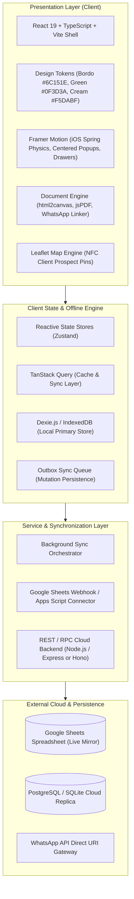

# ARSITEKTUR SISTEM RPA 9 SAUDARA
**Rumah Potong Ayam & Supplier Karkas Fresh Higienis • Halal • Barokah**

*Dokumen Spesifikasi Teknis & Arsitektur Perangkat Lunak*  
*Versi: 1.0.0 | Status: Architecture Design & Foundation Phase*

---

## 1. Ringkasan Eksekutif & Karakteristik Sistem

Aplikasi Manajemen **RPA 9 Saudara** adalah sistem operasional terintegrasi (*end-to-end operational ERP & bookkeeping*) yang dirancang khusus untuk memfasilitasi seluruh rantai pasok rumah potong ayam:
1. **Inflow Ayam Hidup**: Pencatatan pembelian ayam hidup per batch dari peternak/supplier.
2. **Lantai Produksi (Slaughterhouse Floor)**: Pemotongan ayam, pencatatan rendemen karkas bersih dan produk sampingan (ceker, kepala, ati ampela, usus), serta perhitungan upah pekerja borongan berbasis bobot karkas secara otomatis.
3. **Multi-Channel Distribution**:
   - **Headquarters (HQ)**: Penjualan grosir/eceran karkas, part-off, produk sampingan, konversi daging fillet & tulang, serta layanan jasa potong unggas multi-spesies.
   - **Regional Office (RO / Lapak)**: Distribusi harian ke lapak-lapak ritel, rekonsiliasi sisa stok harian, dan verifikasi selisih setoran kas.
4. **Keuangan & Penggajian**: Buku besar operasional, penggajian berbasis sesi produksi & jaga lapak, P&L komprehensif, serta analisis ranking batch paling menguntungkan.
5. **Eksosistem Bisnis Terintegrasi**: Pengelolaan Produk Tambahan, Produk Turunan (Ungkep, Marinasi), Bisnis Sampingan Kartu NFC Google Maps (dengan dashboard peta pin interaktif), serta Buku Kas Pribadi dengan automasi transfer bagi hasil & gaji.

---

## 2. Prinsip Arsitektur Utama (Design Principles)

```
┌────────────────────────────────────────────────────────────────────────┐
│                        RPA 9 SAUDARA ECOSYSTEM                         │
├────────────────────────────────────────────────────────────────────────┤
│  [ Visual Design: Elegant Luxury ]  │  [ Core: Offline-First Ledger ]  │
│  Palet: Bordo #6C151E, Green        │  IndexedDB (Dexie) + Local Cache │
│  #0F3D3A, Cream #F5DABF             │  Outbox Sync Pattern             │
├─────────────────────────────────────┼──────────────────────────────────┤
│  [ Interactions: iOS Smoothness ]   │  [ Integration: Multi-Target ]   │
│  Spring Physics, Centered Popups,   │  Google Sheets Cloud Sync,       │
│  Backdrop Blur, Slide-over Sheets   │  WhatsApp API, PDF/JPG Receipts  │
└────────────────────────────────────────────────────────────────────────┘
```

1. **Offline-First & High Resilience**:
   Lantai pemotongan ayam dan area lapak basah seringkali memiliki koneksi internet yang tidak stabil atau nir-sinyal. Aplikasi harus dapat mencatat transaksi, menimbang karkas, menghitung upah, dan menerbitkan nota secara lokal 100% tanpa delay jaringan. Sinkronisasi ke cloud (Google Sheets & Cloud Database) berjalan asinkron di latar belakang (*background worker*).
2. **Mass-Balance & Double-Entry Stock Ledger**:
   Stok tidak dimanipulasi dengan mutasi angka mentah (`stock = stock - x`), melainkan dicatat melalui *Stock Movement Ledger* yang melacak asal usul batch, konversi berat, susut, dan rendemen secara ketat.
3. **Zero-Latency UI dengan Standar iOS**:
   Seluruh antarmuka dialog mengadopsi mekanisme *iOS Spring Physics*, backdrop blur frosted glass, dan centered floating cards ber-radius *squircle* 26px.
4. **Modular Monolith**:
   Arsitektur kode dibuat bersih, modular, bertipe ketat (*strict TypeScript*), memudahkan pemisahan modul bisnis tanpa over-engineering microservices.

---

## 3. Diagram Arsitektur Tingkat Tinggi (High-Level Architecture)



---

## 4. Rincian Lapisan Arsitektur (Layer Breakdown)

### 4.1 Frontend Presentation Layer
* **Framework**: React 19 + Vite + TypeScript.
* **Styling**: Tailwind CSS dikonfigurasikan dengan palet warna resmi:
  * `bordo-primary`: `#6C151E`
  * `bordo-hover`: `#831B26`
  * `bordo-dark`: `#4D0E15`
  * `green-primary`: `#0F3D3A`
  * `green-light`: `#165753`
  * `green-dark`: `#092624`
  * `cream-primary`: `#F5DABF`
  * `cream-soft`: `#FDF7F0`
  * `cream-card`: `#FAF0E6`
  * `cream-border`: `#E8D0B5`
  * `surface-main`: `#F7F5F0`
* **Popup & Modal Physics**:
  * Centered Pop-up Modal: Memanfaatkan Framer Motion dengan parameter spring:
    `transition: { type: "spring", damping: 25, stiffness: 320, mass: 0.8 }`.
  * Backdrop: `backdrop-blur-md bg-black/45`.
  * Geometry: Continuous curvature squircle border-radius `rounded-[26px]`.
  * Slide-over Form: Untuk form berintensitas input tinggi (Produksi & Pemotongan, Input Penjualan Kompleks).
* **Ekspor Dokumen**:
  * WhatsApp Direct Formatter: URI Scheme `https://wa.me/628882538925?text=...` dengan teks monospaced terformat rapi (KOP Nota resmi, tabel ASCII/bullet, total).
  * Copy JPG: Render DOM node berbasis `html2canvas` langsung disalin ke Clipboard sistem operasi via `navigator.clipboard.write([new ClipboardItem(...)])`.
  * Download PDF: Vektor PDF resolusi tinggi via `jspdf` & `html2canvas` dengan rasio struk termal (80mm) atau A4 landscape untuk laporan keuangan.

### 4.2 State Management & Offline-First Storage
* **Local Primary Database**: IndexedDB yang dibungkus oleh **Dexie.js**.
  * Semua entitas (Ayam Masuk, Batch, Produksi, Karkas, Pekerja, Penjualan, Lapak, Pengeluaran, Kas Pribadi, NFC) tersimpan secara instan di browser/desktop client.
  * Aplikasi tetap berfungsi 100% tanpa koneksi internet.
* **Mutation Outbox Pattern**:
  * Setiap perubahan data menghasilkan *Outbox Event* bertanda waktu ISO, UUID v4, dan status `PENDING`.
  * Saat internet tersedia, *Sync Worker* menguras antrean dan memutakhirkan Google Sheets dan/atau Cloud DB secara berurutan (*FIFO queue*).

### 4.3 Backend & Sinkronisasi Eksternal
* **Google Sheets Connector**:
  * Menggunakan Google Apps Script Web App yang menerima payload POST JSON berotentikasi rahasia (*Bearer Secret Token*).
  * Skrip Apps Script bertindak sebagai *append/update controller* pada sheet terpisah:
    `AyamMasuk`, `Produksi`, `StokRealtime`, `PenjualanHQ`, `DistribusiRO`, `Pengeluaran`, `GajiKaryawan`, `KasPribadi`, `NFC`.
* **Cloud API Option (Node.js)**:
  * Layanan backend ringan (Hono / Express + Prisma/Drizzle) yang dapat di-hosting secara lokal di server LAN rumah potong atau di platform cloud (Railway, VPS, Docker).

---

## 5. Strategi Autentikasi & Otorisasi (RBAC)

Aplikasi memiliki switch peran (*Role-Based Access Control*) cepat yang cocok untuk lantai operasional:
1. **Owner / Super Admin**: Akses penuh ke seluruh modul, Laporan Keuangan, Kas Pribadi, Master Data, dan Konfigurasi Sinkronisasi.
2. **Supervisor Produksi (Lantai Potong)**: Akses ke Ayam Masuk, Produksi & Pemotongan, Stok Realtime, dan Slip Upah Sesi Potong.
3. **Kasir / Sales HQ**: Akses ke Penjualan HQ, Jasa Potong, Stok Realtime, dan Cetak Nota Penjualan.
4. **Koordinator Lapak (RO)**: Akses terbatas ke distribusi stok lapak masing-masing, penginputan sisa stok harian, dan setoran kas.
5. **Akses Cepat PIN (Quick Switch)**: Untuk pergantian operator timbangan di lantai potong tanpa harus login email berulang kali.

---

## 6. Strategi Backup, Keamanan & Pemulihan Bencana

1. **Auto Local Snapshots**:
   Aplikasi secara otomatis mencadangkan database IndexedDB ke penyimpanan file JSON lokal setiap pergantian hari operasional atau saat tombol "Backup Data" ditekan.
2. **Google Sheets Realtime Mirror**:
   Google Sheets berfungsi ganda: sebagai spreadsheet pelaporan bagi pemilik yang ingin memantau dari ponsel, dan sebagai *secondary offsite data backup*.
3. **Data Export & Import**:
   Fitur ekspor seluruh database ke file terenkripsi `.rpa9s` untuk migrasi antar perangkat atau pemulihan darurat (*disaster recovery*).

---

## 7. Model Deployment

* **Mode A: Local-First Desktop / PWA (Rekomendasi untuk Lantai Potong)**
  * Dijalankan di browser Chrome/Edge modern atau dipaketkan dengan Electron/Tauri.
  * Server lokal Node.js berjalan di PC Admin LAN, sehingga tablet timbangan pemotong dapat mengakses alamat IP lokal (`http://192.168.1.xxx:5173`).
* **Mode B: Cloud Deployment (Akses Multi-Lokasi & Pemilik Mobile)**
  * Frontend di-hosting di platform cepat (Vercel / Netlify / Cloudflare Pages).
  * Database sinkronisasi terhubung ke Google Sheets API dan Supabase / PostgreSQL.
