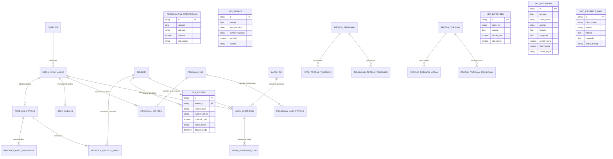

# DESAIN DATABASE & SCHEMA RELASIONAL RPA 9 SAUDARA
**Rumah Potong Ayam & Supplier Karkas Fresh Higienis • Halal • Barokah**

*Dokumen Desain Database, Relasi Entitas & Skema SQL/TypeScript*  
*Versi: 1.0.0 | Status: Architecture Design & Foundation Phase*

---

## 1. Entity Relationship Diagram (ERD)

---

## 2. Skema Tabel Terinci & Data Dictionary

### 2.1 Modul Ayam Masuk & Manajemen Batch

#### Tabel: `suppliers`
Menyimpan master peternakan/pemasok ayam hidup untuk kebutuhan *auto-suggest*.
| Kolom | Tipe Data | Constraint | Deskripsi |
| :--- | :--- | :--- | :--- |
| `id` | VARCHAR(36) | PRIMARY KEY, UUID | ID unik supplier |
| `name` | VARCHAR(120) | NOT NULL, UNIQUE | Nama peternakan / supplier |
| `phone` | VARCHAR(25) | NULLABLE | Nomor telepon / WhatsApp |
| `address` | TEXT | NULLABLE | Alamat peternakan |
| `created_at` | TIMESTAMP | DEFAULT CURRENT_TIMESTAMP | Tanggal pendaftaran |

#### Tabel: `batch_ayam_masuk`
Menyimpan riwayat kedatangan ayam hidup per lot/batch.
| Kolom | Tipe Data | Constraint | Deskripsi |
| :--- | :--- | :--- | :--- |
| `id` | VARCHAR(36) | PRIMARY KEY, UUID | ID unik batch (internal) |
| `batch_code` | VARCHAR(50) | NOT NULL, UNIQUE | Kode batch (format: `BATCH-YYYYMMDD-XX`) |
| `arrival_date` | DATE | NOT NULL | Tanggal ayam masuk |
| `supplier_id` | VARCHAR(36) | NOT NULL, FK -> `suppliers.id` | Referensi supplier |
| `initial_count` | INTEGER | NOT NULL, CHECK (> 0) | Jumlah ekor awal masuk |
| `initial_weight` | DECIMAL(10,2)| NOT NULL, CHECK (> 0) | Total berat ayam hidup (kg) |
| `remaining_count`| INTEGER | NOT NULL, CHECK (>= 0) | Sisa ekor yang belum dipotong |
| `remaining_weight`|DECIMAL(10,2)| NOT NULL, CHECK (>= 0) | Sisa estimasi berat ayam hidup (kg) |
| `avg_weight_per_tail`| DECIMAL(6,3) | NOT NULL | Rata-rata bobot = `initial_weight / initial_count` |
| `size_category` | VARCHAR(15) | NOT NULL, ENUM('BESAR','SEDANG') | Otomatis: > 2.0 kg Besar, <= 2.0 kg Sedang |
| `buy_price_per_kg` | DECIMAL(12,2) | NOT NULL | Harga beli ayam hidup per kg (IDR) |
| `total_purchase_amount` | DECIMAL(14,2) | NOT NULL | Total beli = `initial_weight * buy_price_per_kg` |
| `payment_status` | VARCHAR(15) | NOT NULL, ENUM('LUNAS','DP','UTANG') | Status pembayaran pembelian |
| `amount_paid` | DECIMAL(14,2) | NOT NULL DEFAULT 0 | Jumlah yang sudah dibayar |
| `notes` | TEXT | NULLABLE | Catatan tambahan |
| `created_at` | TIMESTAMP | DEFAULT CURRENT_TIMESTAMP | Waktu pencatatan |

---

### 2.2 Modul Produksi, Pemotongan & Rendemen

#### Tabel: `produksi_potong`
Mencatat sesi pemotongan ayam dari batch aktif.
| Kolom | Tipe Data | Constraint | Deskripsi |
| :--- | :--- | :--- | :--- |
| `id` | VARCHAR(36) | PRIMARY KEY, UUID | ID unik sesi produksi |
| `production_code` | VARCHAR(50) | NOT NULL, UNIQUE | Kode produksi (format: `PRD-YYYYMMDD-XX`) |
| `production_date` | DATE | NOT NULL | Tanggal pemotongan |
| `batch_id` | VARCHAR(36) | NOT NULL, FK -> `batch_ayam_masuk.id` | Batch asal ayam |
| `slaughtered_count`| INTEGER | NOT NULL, CHECK (> 0) | Jumlah ekor yang dipotong pada sesi ini |
| `total_live_weight`| DECIMAL(10,2)| NOT NULL | Total berat hidup dipotong (`count * avg_weight_batch`) |
| `clean_carcass_weight`| DECIMAL(10,2)| NOT NULL | Bobot karkas utuh bersih yang dihasilkan (kg) |
| `rendemen_percent` | DECIMAL(5,2) | NOT NULL | `(clean_carcass_weight / total_live_weight) * 100` |
| `total_worker_wage`| DECIMAL(12,2)| NOT NULL | Total alokasi upah = `clean_carcass_weight * 1000` |
| `notes` | TEXT | NULLABLE | Catatan produksi |

#### Tabel: `produksi_byproducts`
Mencatat berat produk sampingan yang dihasilkan per sesi produksi.
| Kolom | Tipe Data | Constraint | Deskripsi |
| :--- | :--- | :--- | :--- |
| `id` | VARCHAR(36) | PRIMARY KEY, UUID | ID unik item sampingan |
| `production_id` | VARCHAR(36) | NOT NULL, FK -> `produksi_potong.id` | Referensi sesi produksi |
| `byproduct_type`| VARCHAR(25) | NOT NULL, ENUM('CEKER','KEPALA','ATI_AMPELA','USUS') | Jenis produk sampingan |
| `weight_kg` | DECIMAL(8,2) | NOT NULL, CHECK (>= 0) | Bobot hasil sampingan (kg) |

#### Tabel: `workers` (Pekerja)
| Kolom | Tipe Data | Constraint | Deskripsi |
| :--- | :--- | :--- | :--- |
| `id` | VARCHAR(36) | PRIMARY KEY, UUID | ID unik pekerja |
| `name` | VARCHAR(100) | NOT NULL | Nama pekerja |
| `phone` | VARCHAR(25) | NULLABLE | Nomor kontak |
| `is_active` | BOOLEAN | NOT NULL DEFAULT TRUE | Status pekerja aktif |

#### Tabel: `produksi_worker_tasks`
Mencatat keterlibatan pekerja pada sesi pemotongan dan pembagian upah.
| Kolom | Tipe Data | Constraint | Deskripsi |
| :--- | :--- | :--- | :--- |
| `id` | VARCHAR(36) | PRIMARY KEY, UUID | ID rekaman tugas pekerja |
| `production_id` | VARCHAR(36) | NOT NULL, FK -> `produksi_potong.id` | Sesi pemotongan |
| `worker_id` | VARCHAR(36) | NOT NULL, FK -> `workers.id` | Pekerja yang bertugas |
| `tasks_assigned` | JSONB / TEXT | NOT NULL | Checklist tugas (Sembelih, Scalding, Parting, dsb.) |
| `allocated_wage` | DECIMAL(12,2)| NOT NULL | Bagian upah = `total_worker_wage / jumlah_pekerja_sesi` |
| `gaji_ledger_id` | VARCHAR(36) | NULLABLE, FK -> `gaji_ledger.id` | Referensi ke buku besar gaji |

---

### 2.3 Modul Stok Gudang & Ledger Mutasi

#### Tabel: `stok_gudang`
Menyimpan saldo stok produk daging & produk sampingan siap jual per batch.
| Kolom | Tipe Data | Constraint | Deskripsi |
| :--- | :--- | :--- | :--- |
| `id` | VARCHAR(36) | PRIMARY KEY, UUID | ID saldo stok |
| `batch_id` | VARCHAR(36) | NOT NULL, FK -> `batch_ayam_masuk.id` | Batch asal produk |
| `product_type` | VARCHAR(25) | NOT NULL, ENUM('KARKAS','CEKER','KEPALA','ATI_AMPELA','USUS','TULANG') | Tipe produk |
| `current_stock_kg`| DECIMAL(10,2)| NOT NULL, CHECK (>= 0) | Sisa saldo stok aktif (kg) |
| `updated_at` | TIMESTAMP | DEFAULT CURRENT_TIMESTAMP | Waktu pemutakhiran terakhir |

#### Tabel: `stock_movement_ledger`
Mencatat seluruh mutasi keluar-masuk stok untuk auditabilitas 100%.
| Kolom | Tipe Data | Constraint | Deskripsi |
| :--- | :--- | :--- | :--- |
| `id` | VARCHAR(36) | PRIMARY KEY, UUID | ID mutasi |
| `timestamp` | TIMESTAMP | DEFAULT CURRENT_TIMESTAMP | Waktu transaksi mutasi |
| `batch_id` | VARCHAR(36) | NOT NULL | Referensi batch |
| `product_type` | VARCHAR(25) | NOT NULL | Tipe produk |
| `movement_type`| VARCHAR(25) | NOT NULL | `IN_PRODUCTION`, `OUT_HQ_SALE`, `OUT_RO_DISTRIBUTION`, `FILLET_CONVERSION_DECREMENT`, `FILLET_BONE_INCREMENT`, `ADJUSTMENT` |
| `delta_kg` | DECIMAL(10,2)| NOT NULL | Perubahan bobot (positif/negatif) |
| `reference_id` | VARCHAR(50) | NOT NULL | ID transaksi pemicu (ID invoice / ID produksi / ID lapak) |

---

### 2.4 Modul Penjualan Headquarters (HQ) & Jasa Potong

#### Tabel: `penjualan_hq`
| Kolom | Tipe Data | Constraint | Deskripsi |
| :--- | :--- | :--- | :--- |
| `id` | VARCHAR(36) | PRIMARY KEY, UUID | ID transaksi penjualan |
| `invoice_no` | VARCHAR(50) | NOT NULL, UNIQUE | Nomor nota penjualan HQ |
| `transaction_date`| DATE | NOT NULL | Tanggal transaksi |
| `client_name` | VARCHAR(120) | NOT NULL | Nama pelanggan |
| `category` | VARCHAR(25) | NOT NULL, ENUM('ACARA','BISNIS','RUMAHAN','RO','JASA_POTONG') | Kategori pelanggan |
| `gross_total` | DECIMAL(14,2)| NOT NULL | Total harga normal sebelum diskon |
| `voucher_discount`| DECIMAL(14,2)| NOT NULL DEFAULT 0 | Total nilai diskon & voucher |
| `voucher_types` | JSONB / TEXT | NULLABLE | Jenis voucher yang digunakan |
| `net_amount_paid` | DECIMAL(14,2)| NOT NULL | Nominal bersih yang dibayar pelanggan |
| `payment_method`| VARCHAR(15) | NOT NULL, ENUM('TUNAI','QRIS','TRANSFER') | Metode bayar |
| `payment_status`| VARCHAR(15) | NOT NULL, ENUM('LUNAS','BELUM_LUNAS') | Status pembayaran |
| `notes` | TEXT | NULLABLE | Catatan pesanan |

#### Tabel: `penjualan_hq_items`
| Kolom | Tipe Data | Constraint | Deskripsi |
| :--- | :--- | :--- | :--- |
| `id` | VARCHAR(36) | PRIMARY KEY, UUID | ID item |
| `penjualan_id` | VARCHAR(36) | NOT NULL, FK -> `penjualan_hq.id` | Referensi penjualan |
| `batch_id` | VARCHAR(36) | NOT NULL, FK -> `batch_ayam_masuk.id` | Asal batch stok |
| `product_type` | VARCHAR(25) | NOT NULL | Karkas, Ceker, Kepala, dsb. |
| `cut_detail` | VARCHAR(50) | NULLABLE | Utuh, Potong 4, Potong 8, dsb. |
| `weight_kg` | DECIMAL(10,2)| NOT NULL | Berat produk terjual (kg) |
| `unit_price` | DECIMAL(12,2)| NOT NULL | Harga per kg |
| `subtotal` | DECIMAL(14,2)| NOT NULL | `weight_kg * unit_price` |
| `is_fillet` | BOOLEAN | NOT NULL DEFAULT FALSE | Penanda produk fillet |
| `fillet_meat_kg`| DECIMAL(10,2)| NULLABLE | Hasil daging fillet (kg) |
| `fillet_bone_kg`| DECIMAL(10,2)| NULLABLE | Hasil tulang fillet (kg) |

#### Tabel: `penjualan_jasa_potong`
| Kolom | Tipe Data | Constraint | Deskripsi |
| :--- | :--- | :--- | :--- |
| `id` | VARCHAR(36) | PRIMARY KEY, UUID | ID transaksi jasa potong |
| `penjualan_id` | VARCHAR(36) | NOT NULL, FK -> `penjualan_hq.id` | Referensi invoice HQ |
| `poultry_type` | VARCHAR(30) | NOT NULL | Broiler, Kampung, Bebek, Mentok |
| `size_grade` | VARCHAR(15) | NOT NULL, ENUM('BESAR','SEDANG','KECIL') | Ukuran unggas |
| `tail_count` | INTEGER | NOT NULL | Jumlah ekor yang dipotongkan |
| `fee_per_tail` | DECIMAL(10,2)| NOT NULL | Tarif potong per ekor |
| `subtotal` | DECIMAL(12,2)| NOT NULL | `tail_count * fee_per_tail` |

---

### 2.5 Modul Regional Office (RO / Lapak)

#### Tabel: `master_lapak_ro`
| Kolom | Tipe Data | Constraint | Deskripsi |
| :--- | :--- | :--- | :--- |
| `id` | VARCHAR(36) | PRIMARY KEY, UUID | ID lapak |
| `lapak_number` | VARCHAR(20) | NOT NULL | Nomor lapak (misal: `#01`, `#02`) |
| `location_name`| VARCHAR(120) | NOT NULL | Lokasi lapak (misal: Pasar Induk) |
| `is_active` | BOOLEAN | NOT NULL DEFAULT TRUE | Status lapak beroperasi |

#### Tabel: `lapak_distribusi_harian`
| Kolom | Tipe Data | Constraint | Deskripsi |
| :--- | :--- | :--- | :--- |
| `id` | VARCHAR(36) | PRIMARY KEY, UUID | ID distribusi |
| `date` | DATE | NOT NULL | Tanggal distribusi ke lapak |
| `lapak_id` | VARCHAR(36) | NOT NULL, FK -> `master_lapak_ro.id` | Lapak tujuan |
| `batch_id` | VARCHAR(36) | NOT NULL, FK -> `batch_ayam_masuk.id` | Asal batch karkas/produk |
| `keeper_worker_id`| VARCHAR(36)| NOT NULL, FK -> `workers.id` | Pekerja / penjaga lapak |
| `keeper_wage` | DECIMAL(12,2)| NOT NULL DEFAULT 0 | Gaji jaga lapak (input manual) |
| `expected_revenue`| DECIMAL(14,2)| NOT NULL | Uang yang seharusnya didapatkan |
| `actual_revenue` | DECIMAL(14,2)| NOT NULL | Uang realita yang disetorkan |
| `discrepancy` | DECIMAL(14,2)| NOT NULL | Selisih = `actual_revenue - expected_revenue` |
| `notes` | TEXT | NULLABLE | Catatan harian lapak |

#### Tabel: `lapak_distribusi_items`
| Kolom | Tipe Data | Constraint | Deskripsi |
| :--- | :--- | :--- | :--- |
| `id` | VARCHAR(36) | PRIMARY KEY, UUID | ID item lapak |
| `distribusi_id`| VARCHAR(36) | NOT NULL, FK -> `lapak_distribusi_harian.id` | Referensi distribusi |
| `product_type` | VARCHAR(25) | NOT NULL | Karkas, Ceker, Kepala, Ati Ampela, Usus |
| `sent_kg` | DECIMAL(8,2) | NOT NULL | Stok yang dibawa ke lapak (kg) |
| `remaining_kg` | DECIMAL(8,2) | NOT NULL | Sisa stok yang tidak terjual (kg) |
| `sold_kg` | DECIMAL(8,2) | NOT NULL | Terjual = `sent_kg - remaining_kg` |
| `unit_price` | DECIMAL(12,2)| NOT NULL | Harga default satuan produk |
| `subtotal_expected`| DECIMAL(12,2)| NOT NULL | `sold_kg * unit_price` |

---

### 2.6 Modul Biaya Operasional & Penggajian Karyawan

#### Tabel: `pengeluaran_operasional`
| Kolom | Tipe Data | Constraint | Deskripsi |
| :--- | :--- | :--- | :--- |
| `id` | VARCHAR(36) | PRIMARY KEY, UUID | ID pengeluaran |
| `expense_date` | DATE | NOT NULL | Tanggal pengeluaran |
| `category` | VARCHAR(30) | NOT NULL | Gas, Plastik & Kemasan, Listrik & Air, Bensin, Es Batu, Konsumsi, Pakan, Sewa Alat, Beban HPP Stok Terbuang, Lain-lain |
| `amount` | DECIMAL(14,2)| NOT NULL, CHECK (> 0) | Nominal biaya (IDR) |
| `notes` | TEXT | NULLABLE | Keterangan tambahan |

#### Tabel: `gaji_ledger`
Buku besar sentral untuk mencatat seluruh hak upah pekerja dan status pembayaran.
| Kolom | Tipe Data | Constraint | Deskripsi |
| :--- | :--- | :--- | :--- |
| `id` | VARCHAR(36) | PRIMARY KEY, UUID | ID transaksi upah |
| `worker_id` | VARCHAR(36) | NOT NULL, FK -> `workers.id` | Penerima upah |
| `source_type` | VARCHAR(20) | NOT NULL, ENUM('PRODUKSI','JAGA_LAPAK') | Sumber upah |
| `source_ref_id`| VARCHAR(36) | NOT NULL | ID Sesi Produksi atau ID Distribusi Lapak |
| `accrual_date` | DATE | NOT NULL | Tanggal pekerjaan diselesaikan |
| `wage_amount` | DECIMAL(12,2)| NOT NULL | Nilai upah yang berhak diterima |
| `payment_status`| VARCHAR(15) | NOT NULL, ENUM('BELUM_DIBAYAR','SUDAH_DIBAYAR') | Status pembayaran |
| `paid_at` | TIMESTAMP | NULLABLE | Waktu pembayaran dilakukan |
| `auto_transferred_to_fathan_kas`| BOOLEAN | NOT NULL DEFAULT FALSE | Flag penanda transfer otomatis ke kas pribadi jika pekerja bernama Fathan |

---

### 2.7 Modul Bisnis & Kas Pribadi, Produk Turunan & NFC Google Maps

#### Tabel: `kas_pribadi_transaksi`
| Kolom | Tipe Data | Constraint | Deskripsi |
| :--- | :--- | :--- | :--- |
| `id` | VARCHAR(36) | PRIMARY KEY, UUID | ID transaksi kas pribadi |
| `date` | DATE | NOT NULL | Tanggal transaksi |
| `flow_type` | VARCHAR(10) | NOT NULL, ENUM('MASUK','KELUAR') | Aliran kas |
| `source_category`| VARCHAR(30)| NOT NULL | `BEBAS`, `AUTO_GAJI_FATHAN`, `AUTO_NFC_PROFIT_50`, `PENGELUARAN_PRIBADI` |
| `amount` | DECIMAL(14,2)| NOT NULL, CHECK (> 0) | Nominal transaksi |
| `notes` | TEXT | NULLABLE | Keterangan keperluan |

#### Tabel: `produk_turunan` & Relasinya
* `produk_turunan`: Master produk (Ayam Ungkep, Ayam Marinasi, Fried Chicken, dll).
* `produk_turunan_modal`: Catat pembelian modal/bahan (Tanggal, bahan, nominal, catatan).
* `produk_turunan_penjualan`: Catat penjualan produk turunan (Tanggal, klien/lapak, jumlah order, satuan, nominal).

#### Tabel: Bisnis Kartu NFC Google Maps
* `nfc_batch_beli`: Pembelian kartu kosong (Tanggal, no batch auto, jumlah kartu, total biaya, supplier).
* `nfc_penjualan`: Penjualan kartu (Tanggal, klien, alamat, koordinat lat/long, direct link Google Maps, jumlah kartu, total harga, metode bayar, status bayar).
* `nfc_operasional`: Biaya operasional kartu NFC (Tanggal, nama kebutuhan, nominal).
* `nfc_prospect_map`: Database titik lokasi kunjungan dengan koordinat geografis untuk visualisasi peta interaktif (Status: `CLOSING` [Pin Hijau `#0F3D3A`] vs `BELUM_CLOSING` [Pin Bordo `#6C151E`]).

---

## 3. Strategi Indexing & Optimasi Query
1. `idx_batch_remaining`: Index pada `batch_ayam_masuk(remaining_count)` untuk mempercepat pemuatan dropdown seleksi batch yang masih memiliki ayam hidup.
2. `idx_stock_lookup`: Composite index `stok_gudang(batch_id, product_type)` untuk pembacaan saldo stok realtime berkecepatan mikro-detik.
3. `idx_gaji_unpaid`: Index `gaji_ledger(payment_status, worker_id)` untuk dashboard deteksi tunggakan upah pekerja.
4. `idx_nfc_coords`: Index `nfc_prospect_map(latitude, longitude)` untuk rendering penanda peta interaktif (Leaflet Pins).
