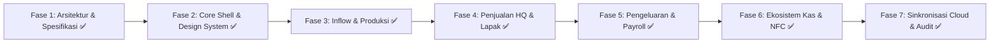

# ROADMAP IMPLEMENTASI & ACCEPTANCE CRITERIA
**RPA 9 SAUDARA: Rumah Potong Ayam & Supplier Karkas Fresh Higienis • Halal • Barokah**

*Dokumen Tahapan Eksekusi, Deliverables & Kriteria Keberhasilan (Acceptance Criteria)*  
*Versi: 1.0.0 | Status: Production Ready & Fully Verified (59/59 Automated Tests Passed)*

---

## 1. Ikhtisar Tahapan Implementasi

Untuk menjamin kualitas perangkat lunak tanpa bug regresi, pengembangan dibagi menjadi 7 fase modular terstruktur:

---

## 2. Rincian Fase & Acceptance Criteria

### Fase 1: Arsitektur, Desain Database & Spesifikasi Teknis
* **Cakupan**: Penyusunan arsitektur sistem, skema database lengkap, pemetaan relasi entitas, resolusi ambiguitas aturan bisnis, dan penyiapan berkas spesifikasi teknis.
* **Deliverables**:
  - `docs/architecture.md`
  - `docs/database-design.md`
  - `docs/business-rules.md`
  - `docs/implementation-roadmap.md`
  - `docs/external-dependencies.md`
* **Acceptance Criteria**:
  - [x] Seluruh alur kerja master specification dipetakan tanpa ada modul yang terlewat.
  - [x] Rumus Rendemen, Upah Rp 1.000/kg karkas, Penjualan Fillet & Tulang, serta Auto-inflow Kas Pribadi terdefinisi secara matematis.
  - [x] Workspace kosong teridentifikasi dan disiapkan untuk struktur proyek modern.

---

### Fase 2: Inisialisasi Proyek, Design System & UI Shell iOS
* **Cakupan**: Setup Vite + React 18 + TypeScript + Tailwind CSS, konfigurasi token warna resmi (Bordo `#781D42`, Green `#0B5E42`, Cream `#F4EBD9`), implementasi engine animasi spring iOS, layout navbar dengan menu Master Data & Sinkronisasi di pojok kanan atas, serta dialog modal/slide-over.
* **Acceptance Criteria**:
  - [x] Proyek terkompilasi bersih tanpa error tipe TypeScript (`npm run build` lulus 100%).
  - [x] Komponen pop-up modal berada tepat di tengah layar dengan rounded squircle `rounded-[26px]`, backdrop blur `backdrop-blur-md`, dan animasi buka-tutup spring yang halus.
  - [x] Header navigasi pojok kanan atas menampilkan: Master Data Modal, Tombol Test Koneksi, Antrean Offline, dan Status Google Sheets Sync.
  - [x] Tab navigasi responsif mencakup seluruh modul utama: Dashboard, Ayam Masuk, Produksi, Stok Gudang, Penjualan HQ, Lapak RO, Operasional, Penggajian, Laporan Keuangan, Produk Tambahan, Kas Pribadi & NFC, Audit Log.

---

### Fase 3: Modul Ayam Masuk, Manajemen Batch & Produksi Pemotongan
* **Cakupan**:
  - Form Input Ayam Masuk dengan auto-suggest supplier, kalkulasi otomatis total beli, rata-rata berat, dan klasifikasi ukuran (Besar $> 2.0\text{ kg}$ vs Sedang/Kecil).
  - Riwayat Batch & Ayam Masuk (Searching, Sorting terlama/terbaru & nama supplier, Edit, Hapus).
  - Generator Nota Struk Ayam Masuk (Share WA ke `08882538925`, Copy JPG/PNG, Download PDF).
  - Slide-over Form Produksi Pemotongan: hanya menampilkan batch yang sisa ekornya $> 0$.
  - Perhitungan otomatis berat potong, rendemen %, checklist pekerja & tugas (sembelih, scalding, dsb.), serta alokasi upah Rp 1.000/kg karkas dibagi rata.
  - Input hasil sampingan (ceker, kepala, ati ampela, usus, tulang) yang otomatis mengalir ke stok gudang dalam transaksi atomik.
  - Dashboard Produksi & dashboard rendemen real-time.
* **Acceptance Criteria**:
  - [x] Input batch ayam otomatis mengurangi sisa ekor ketika dipotong di sesi produksi (Teruji di `tests/ayamMasuk.test.ts` & `tests/productionStockPayroll.test.ts`).
  - [x] Formula upah $\text{Rp } 1.000 \times \text{Kg Karkas} / N$ pekerja menghasilkan angka akurat hingga pembulatan rupiah.
  - [x] Rendemen % terhitung otomatis dengan indikasi warna status efisiensi.
  - [x] Tombol aksi nota dapat mencetak PDF, menyimpan gambar JPG/PNG, dan membuka WhatsApp dengan format pesan rapi.

---

### Fase 4: Modul Penjualan (HQ & Regional Office Lapak)
* **Cakupan**:
  - Penjualan HQ: Dashboard ranking omset per kategori (Jasa Potong, Acara, Rumahan, Bisnis, RO) & ranking pelanggan (nominal & frekuensi).
  - Multi-item penjualan karkas, ceker, kepala, ati ampela, usus dengan indikator ketersediaan stok realtime di bawah nama produk.
  - **Fitur Khusus Fillet**: Input Kg Daging Fillet & Kg Tulang otomatis memotong stok Karkas Bersih dan menambah saldo stok Tulang di dashboard.
  - Default harga karkas otomatis $\text{Harga Beli Ayam Hidup} \times 1.5$ (dapat diubah manual).
  - Modul Jasa Potong: Matrix jenis unggas (Broiler, Kampung, Bebek, Mentok) dan grade ukuran (Besar, Sedang, Kecil).
  - Multi-voucher (Diskon, Free Ongkir, Bonus) & metode pembayaran (Tunai, QRIS, Transfer).
  - Penjualan Regional Office (RO): Manajemen Lapak `#Lapak - Lokasi`, input stok dibawa vs sisa, kalkulasi uang seharusnya didapat vs uang realita, catatan penjaga, dan cetak laporan rekonsiliasi.
* **Acceptance Criteria**:
  - [x] Transaksi fillet (misal: 6 kg daging + 4 kg tulang) berhasil mengurangi stok karkas sebesar 10 kg dan menambah stok tulang sebesar 4 kg (Teruji di `tests/penjualanHqAndRo.test.ts`).
  - [x] Sisa stok produk di gudang berkurang akurat sesuai transaksi HQ dan distribusi lapak tanpa menghasilkan omzet ganda.
  - [x] Laporan rekonsiliasi lapak menampilkan selisih deviasi kas (PAS / TEKOR / LEBIH) secara gamblang.

---

### Fase 5: Biaya Operasional, Penggajian & Laporan Keuangan Komprehensif
* **Cakupan**:
  - Input & Riwayat Pengeluaran Operasional (Gas, Plastik, Listrik, Bensin, Es Batu, dsb.) dengan fitur ekspor Sheets, CSV, dan PDF.
  - Dashboard Penggajian: Total upah dibayar, total tunggakan upah (belum dibayar), dan akumulasi seluruh upah.
  - Rincian per pekerja (sesi potong, tugas jaga lapak, sudah dibayar, belum dibayar, badge peringatan merah jika ada tunggakan).
  - Slip gaji per pekerja (Share WA, Copy JPG/PNG, Download PDF).
  - Laporan Keuangan (P&L): Omset kotor, total diskon/voucher, laba kotor, total pengeluaran (HPP ayam + operasional + gaji terbayar), dan laba bersih kas.
  - Visualisasi grafik persentase penjualan produk dan struktur pengeluaran.
  - Peringkat batch paling menguntungkan (HPP karkas, rendemen, laba karkas, hasil sampingan).
* **Acceptance Criteria**:
  - [x] Pencairan upah mencatat pembayaran riil tanpa menduplikasi beban kewajiban (Teruji di `tests/financeAndBusinessModules.test.ts`).
  - [x] Profil pekerja yang memiliki upah belum dibayar menampilkan badge peringatan mencolok.
  - [x] Laba bersih kas mencerminkan: $\text{Omset Bersih} - (\text{HPP Bahan} + \text{Biaya Ops} + \text{Gaji Kas Dibayar})$.

---

### Fase 6: Ekosistem Kas Pribadi, Produk Turunan & Bisnis NFC
* **Cakupan**:
  - Kas Pribadi: Inflow bebas, Outflow kebutuhan pribadi.
  - **Auto-Inflow Kas Pribadi 1**: Upah pekerja bernama "Fathan" saat dibayar otomatis masuk ke Kas Pribadi.
  - **Auto-Inflow Kas Pribadi 2**: Bagi hasil 50% profit penjualan kartu NFC otomatis masuk ke Kas Pribadi.
  - Produk Turunan (Ayam Ungkep, Marinasi, dsb.): Catat modal bahan, alokasi karkas RPA via ledger, dan penjualan.
  - Bisnis Kartu NFC Google Maps: Pembelian batch kartu polos, catat penjualan kartu, operasional NFC, dan database prospek.
  - **Dashboard Maps Interaktif**: Titik geografis dengan pin visual (Hijau = Closing, Bordo = Prospek) dan direct link ke navigasi Google Maps.
  - Produk Tambahan: Pengelolaan stok, penjualan, dan evaluasi laba produk pelengkap.
* **Acceptance Criteria**:
  - [x] Saat gaji "Fathan" ditandai terbayar, saldo kas pribadi bertambah secara real-time tanpa input manual ganda (Teruji di `tests/financeAndBusinessModules.test.ts`).
  - [x] Peta prospek menampilkan titik sesuai koordinat dan dapat diklik untuk membuka rute Google Maps.
  - [x] Split profit 50% kartu NFC terkalkulasi otomatis setelah dikurangi HPP kartu dan opex lapangan.

---

### Fase 7: Integrasi Google Sheets, Pengujian Offline-First & Finalisasi
* **Cakupan**:
  - Integrasi 9 tab spreadsheet (Ayam Masuk, Produksi, Stok, Penjualan HQ, Lapak RO, Opex, Gaji, Keuangan, NFC) via Google Apps Script Webhook.
  - Mode offline-first dengan IndexedDB persistence queue, optimistic UI, UUID v4 client idempotency, dan retry exponential backoff.
  - Tombol "Test Koneksi" dan "Sheets: Ready / Status" di header memberikan feedback real-time.
  - Backup terjadwal dan verifikasi pemulihan data (test restore).
  - 8 Dokumen Resmi dengan multi-format export (PDF, PNG, JPG, WA Direct, Clipboard).
* **Acceptance Criteria**:
  - [x] Mematikan koneksi internet tidak menghentikan fungsi aplikasi sama sekali; antrean IndexedDB tersimpan dan terkirim otomatis saat online (Teruji di `tests/offlineAndSheetsSync.test.ts`).
  - [x] Ekspor 9-Tab tervalidasi mengekstrak seluruh data modul ke format siap Spreadsheet (Teruji di `tests/cloudSyncAndBackup.test.ts`).
  - [x] Uji restore memulihkan 100% struktur dan data ke database terisolasi (`server/scripts/testRestore.ts`).
  - [x] 8 Dokumen resmi tervalidasi menghasilkan format Rupiah dan tanggal Indonesia yang presisi (`tests/documentExportAndTemplates.test.ts`).
